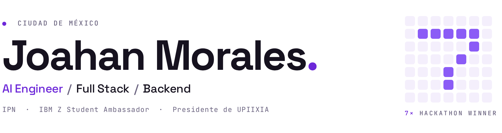
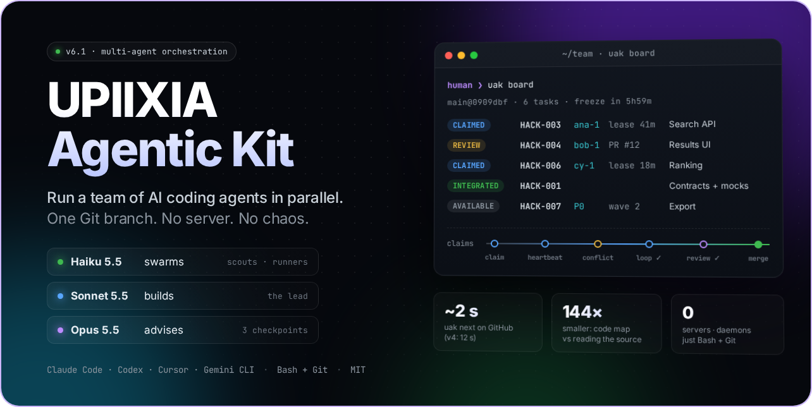
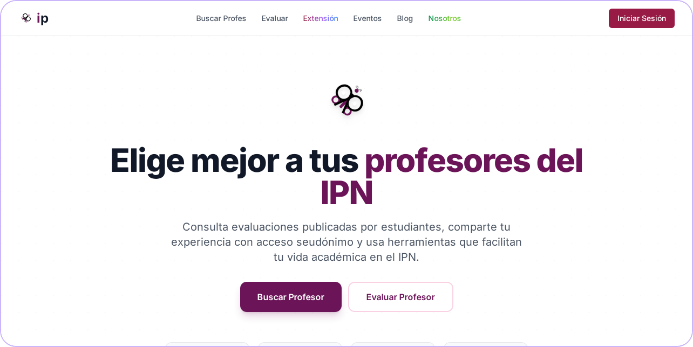

<picture>
  <source media="(prefers-color-scheme: dark)" srcset="assets/header-dark.png">
  
</picture>

Full stack en el IPN · AI Engineer · 7 hackathons ganados. 
Hice IPNProfes y el UPIIXIA Agentic Kit. 
Presidente de UPIIXIA · IBM Z Student Ambassador.

**Experiencia**

Full Stack Software Engineer · IPN, Centro Nacional de Cálculo &nbsp;2026 – hoy 
IBM Z Student Ambassador · IBM &nbsp;2026 – hoy 
Software Developer · Prestigio en Traslado Automotriz &nbsp;2025 – 2026

 

### Proyectos

<table>
<tr>
<td width="50%" valign="top">

<h4>UPIIXIA Agentic Kit</h4>
Varios agentes de IA en un mismo repo, con tareas, pruebas y revisiones.
  
Claude Code · Codex · Cursor · Gemini &nbsp;·&nbsp; 3 de los 7 hackathons se ganaron con él
  

</td>
<td width="50%" valign="top">

<h4>IPNProfes</h4>
Evaluaciones de profesores del IPN. Extensión de Chrome para armar horarios en el SAES.
  
React · Supabase · Cloudflare
  

</td>
</tr>
</table>

### 7 hackathons ganados

| | Hackathon | Proyecto |
|:--|:--|:--|
| **1.º** | OpenAI × Kavak | **AXIA** · daños en autos, con IA que aprende de sus errores |
| **1.º** | Chilangatón 2026 | Mapa del comercio popular por día y hora |
| **1.º** | HackADA 2026 | Rutas de compra 100 % local |
| **1.º** | SEDECO × Saptiva AI | **MercurIA** · dónde poner un festival |
| **1.º** · Track IBM | Talent Land 2026 | **LumivIA** · rutas que cuidan el ambiente |
| **3.º** · Best Bolt Project | AI Tinkerers × ElevenLabs | **Psyness** · soporte emocional por voz |
| **Best Open Source** | Mobility & AI Hackathon · ÖBB | **RailSense** · Viena vs CDMX, en trenes |

### Stack

<picture>
  <source media="(prefers-color-scheme: dark)" srcset="https://skillicons.dev/icons?i=java%2Cspring%2Cpython%2Cjs%2Cts%2Creact%2Cnodejs%2Cpostgres%2Cmysql%2Cmongodb%2Credis%2Csupabase%2Ccloudflare%2Cdocker%2Cgit%2Clinux&theme=dark&perline=8">
  
</picture>

### Actividad

<picture>
  <source media="(prefers-color-scheme: dark)" srcset="https://streak-stats.demolab.com/?user=JoahanMorales&hide_border=true&background=00000000&ring=8B5CF6&fire=A78BFA&currStreakNum=E9E6F2&sideNums=E9E6F2&currStreakLabel=A78BFA&sideLabels=8E86A3&dates=8E86A3&stroke=2A2438&locale=es">
  
</picture>

<picture>
  <source media="(prefers-color-scheme: dark)" srcset="https://raw.githubusercontent.com/JoahanMorales/JoahanMorales/output/contributions-dark.svg">
  
</picture>

### Conecta conmigo

  
