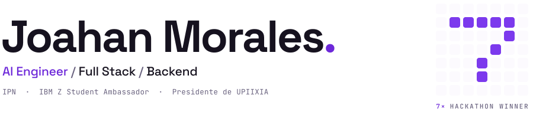
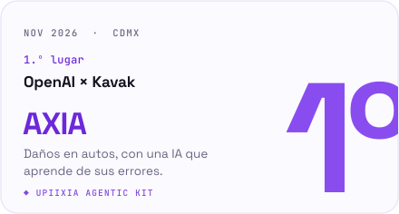
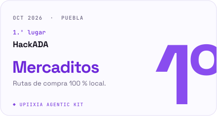
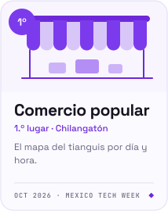
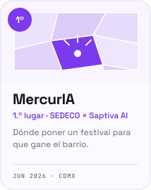
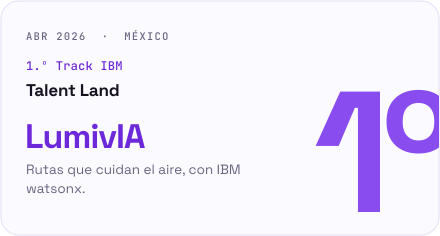
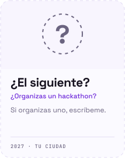
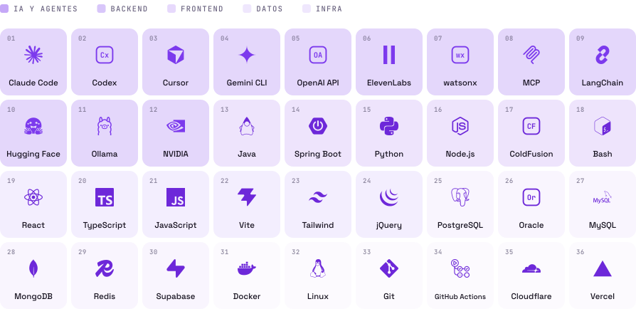

<!-- header:start -->
<picture><source media="(prefers-color-scheme: dark)" srcset="assets/gen/header-dark.svg"></picture>
<!-- header:end -->

Full stack en el IPN · AI Engineer · 7 hackathons ganados. 
Hice IPNProfes y el UPIIXIA Agentic Kit. 
Presidente de UPIIXIA · IBM Z Student Ambassador.

**Experiencia**

Full Stack Software Engineer · IPN, Centro Nacional de Cálculo &nbsp;2026 – hoy 
IBM Z Student Ambassador · IBM &nbsp;2026 – hoy 
Software Developer · Prestigio en Traslado Automotriz &nbsp;2025 – 2026

 

### Proyectos

<table>
<tr>
<td width="50%" valign="top">

<h4>UPIIXIA Agentic Kit</h4>
Varios agentes de IA en un mismo repo, con tareas, pruebas y revisiones.
  
Claude Code · Codex · Cursor · Gemini &nbsp;·&nbsp; 339 pruebas en Linux, macOS y Windows
  

</td>
<td width="50%" valign="top">

<h4>IPNProfes</h4>
Evaluaciones de profesores del IPN. Extensión de Chrome para armar horarios en el SAES.
  
React · Supabase · Cloudflare
  

</td>
</tr>
</table>

### Hackathons

<!-- hackathons:start -->

<a href="https://github.com/G10hdz/deus-ex-machina"><picture><source media="(prefers-color-scheme: dark)" srcset="assets/gen/hk-axia-dark.svg"></picture></a>
<a href="https://github.com/rvvictor/HackADA-Upiixia"><picture><source media="(prefers-color-scheme: dark)" srcset="assets/gen/hk-mercaditos-dark.svg"></picture></a>
 
<a href="https://github.com/rvvictor/Chilangaton-Upiixia"><picture><source media="(prefers-color-scheme: dark)" srcset="assets/gen/hk-comercio-popular-dark.svg"></picture></a>
<picture><source media="(prefers-color-scheme: dark)" srcset="assets/gen/hk-mercuria-dark.svg"></picture>
 
<a href="https://github.com/FerVarg24/LumivIA"><picture><source media="(prefers-color-scheme: dark)" srcset="assets/gen/hk-lumivia-dark.svg"></picture></a>
<a href="https://github.com/AxolutionsDevs/EvenLabs-Hack"><picture><source media="(prefers-color-scheme: dark)" srcset="assets/gen/hk-psyness-dark.svg"></picture></a>
 
<a href="https://github.com/AxolutionsDevs/MobilityAI-Hackaton"><picture><source media="(prefers-color-scheme: dark)" srcset="assets/gen/hk-railsense-dark.svg"></picture></a>
<a href="mailto:joahanmorales07@gmail.com"><picture><source media="(prefers-color-scheme: dark)" srcset="assets/gen/hk-next-dark.svg"></picture></a>

<!-- hackathons:end -->

### Stack

<!-- stack:start -->
<picture><source media="(prefers-color-scheme: dark)" srcset="assets/gen/stack-dark.svg"></picture>
<!-- stack:end -->

### Actividad

<picture>
  <source media="(prefers-color-scheme: dark)" srcset="https://streak-stats.demolab.com/?user=JoahanMorales&hide_border=true&background=00000000&ring=8B5CF6&fire=A78BFA&currStreakNum=E9E6F2&sideNums=E9E6F2&currStreakLabel=A78BFA&sideLabels=8E86A3&dates=8E86A3&stroke=2A2438&locale=es">
  
</picture>

<picture>
  <source media="(prefers-color-scheme: dark)" srcset="https://raw.githubusercontent.com/JoahanMorales/JoahanMorales/output/contributions-dark.svg">
  
</picture>

### Conecta conmigo

  
