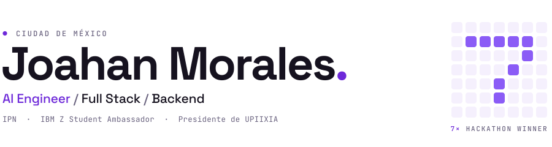

<picture>
  <source media="(prefers-color-scheme: dark)" srcset="assets/header-dark.svg">
  
</picture>

Full stack en el IPN · AI Engineer · 7 hackathons ganados. 
Hice IPNProfes y el UPIIXIA Agentic Kit. 
Presidente de UPIIXIA · IBM Z Student Ambassador.

**Experiencia**

Full Stack Software Engineer · IPN, Centro Nacional de Cálculo &nbsp;2026 – hoy 
IBM Z Student Ambassador · IBM &nbsp;2026 – hoy 
Software Developer · Prestigio en Traslado Automotriz &nbsp;2025 – 2026

 

### Proyectos

<table>
<tr>
<td width="50%" valign="top">

<h4>UPIIXIA Agentic Kit</h4>
Varios agentes de IA en un mismo repo, con tareas, pruebas y revisiones.
  
Claude Code · Codex · Cursor · Gemini &nbsp;·&nbsp; 339 pruebas en Linux, macOS y Windows
  

</td>
<td width="50%" valign="top">

<h4>IPNProfes</h4>
Evaluaciones de profesores del IPN. Extensión de Chrome para armar horarios en el SAES.
  
React · Supabase · Cloudflare
  

</td>
</tr>
</table>

### Hackathons

<!-- hackathons:start -->
**7 premios**, 5 de ellos primer lugar.

<table>
<tr>
<td width="25%" valign="top">
 
OpenAI × Kavak · CDMX
<h4><a href="https://github.com/G10hdz/deus-ex-machina"><b>AXIA</b></a> ◆</h4>
Daños en autos, con una IA que aprende de sus errores.
</td>
<td width="25%" valign="top">
 
HackADA · Puebla
<h4><a href="https://github.com/rvvictor/HackADA-Upiixia"><b>Mercaditos</b></a> ◆</h4>
Rutas de compra 100 % local.
</td>
<td width="25%" valign="top">
 
Chilangatón · Mexico Tech Week
<h4><a href="https://github.com/rvvictor/Chilangaton-Upiixia"><b>Comercio popular</b></a> ◆</h4>
El mapa del tianguis por día y hora.
</td>
<td width="25%" valign="top">
 
SEDECO × Saptiva AI · CDMX
<h4><b>MercurIA</b></h4>
Dónde poner un festival para que gane el barrio.
</td>
</tr>
<tr>
<td width="25%" valign="top">
 
Talent Land · México
<h4><a href="https://github.com/FerVarg24/LumivIA"><b>LumivIA</b></a></h4>
Rutas que cuidan el aire, con IBM watsonx.
</td>
<td width="25%" valign="top">
 
ElevenLabs Hackathon · CDMX
<h4><a href="https://github.com/AxolutionsDevs/EvenLabs-Hack"><b>Psyness</b></a></h4>
Soporte emocional con voz en tiempo real.
</td>
<td width="25%" valign="top">
 
Mobility & AI · Reto ÖBB
<h4><a href="https://github.com/AxolutionsDevs/MobilityAI-Hackaton"><b>RailSense</b></a></h4>
Viena contra CDMX, en trenes.
</td>
<td width="25%" valign="top">
 
&nbsp;
<h4>¿El siguiente?</h4>
<a href="mailto:joahanmorales07@gmail.com">Si organizas uno, escríbeme.</a>
</td>
</tr>
</table>

◆ hecho con UPIIXIA Agentic Kit
<!-- hackathons:end -->

### Stack

<!-- stack:start -->
<table>
<tr>
<td valign="top"><b>IA y agentes</b></td>
<td><code>&nbsp;Claude&nbsp;Code</code> <code>&nbsp;Codex</code> <code>&nbsp;Cursor</code> <code>&nbsp;Gemini&nbsp;CLI</code> <code>&nbsp;OpenAI&nbsp;API</code> <code>&nbsp;ElevenLabs</code> <code>&nbsp;watsonx</code> <code>&nbsp;MCP</code> <code>&nbsp;Ollama</code> <code>&nbsp;NVIDIA</code></td>
</tr>
<tr>
<td valign="top"><b>Backend</b></td>
<td><code>&nbsp;Java</code> <code>&nbsp;Spring&nbsp;Boot</code> <code>&nbsp;Python</code> <code>&nbsp;Node.js</code> <code>&nbsp;ColdFusion</code> <code>&nbsp;Bash</code></td>
</tr>
<tr>
<td valign="top"><b>Frontend</b></td>
<td><code>&nbsp;React</code> <code>&nbsp;TypeScript</code> <code>&nbsp;JavaScript</code> <code>&nbsp;Vite</code> <code>&nbsp;Tailwind</code> <code>&nbsp;jQuery</code></td>
</tr>
<tr>
<td valign="top"><b>Datos</b></td>
<td><code>&nbsp;PostgreSQL</code> <code>&nbsp;Oracle</code> <code>&nbsp;MySQL</code> <code>&nbsp;MongoDB</code> <code>&nbsp;Redis</code> <code>&nbsp;Supabase</code></td>
</tr>
<tr>
<td valign="top"><b>Infra</b></td>
<td><code>&nbsp;Docker</code> <code>&nbsp;Linux</code> <code>&nbsp;Git</code> <code>&nbsp;GitHub&nbsp;Actions</code> <code>&nbsp;Cloudflare</code> <code>&nbsp;Vercel</code></td>
</tr>
</table>
<!-- stack:end -->

### Actividad

<picture>
  <source media="(prefers-color-scheme: dark)" srcset="https://streak-stats.demolab.com/?user=JoahanMorales&hide_border=true&background=00000000&ring=8B5CF6&fire=A78BFA&currStreakNum=E9E6F2&sideNums=E9E6F2&currStreakLabel=A78BFA&sideLabels=8E86A3&dates=8E86A3&stroke=2A2438&locale=es">
  
</picture>

<picture>
  <source media="(prefers-color-scheme: dark)" srcset="https://raw.githubusercontent.com/JoahanMorales/JoahanMorales/output/contributions-dark.svg">
  
</picture>

### Conecta conmigo

  
