<!-- Generated by scripts/build_readme.py from data/profile.json. Edit those, not this file. -->

<picture><source media="(prefers-color-scheme: dark)" srcset="assets/gen/header-dark.svg"></picture>

<picture><source media="(prefers-color-scheme: dark)" srcset="assets/gen/about-dark.svg">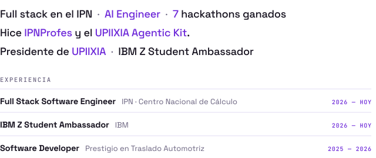</picture>

<picture><source media="(prefers-color-scheme: dark)" srcset="assets/gen/sec-proyectos-dark.svg"></picture>

<a href="https://github.com/JoahanMorales/upiixia-agentic-kit"><picture><source media="(prefers-color-scheme: dark)" srcset="assets/gen/pr-upiixia-agentic-kit-dark.svg">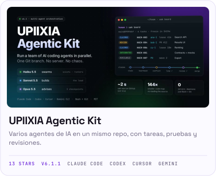</picture></a>
<a href="https://ipnprofes.com"><picture><source media="(prefers-color-scheme: dark)" srcset="assets/gen/pr-ipnprofes-dark.svg">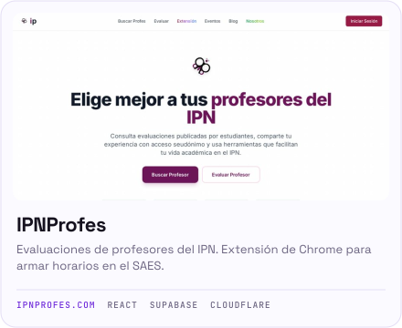</picture></a>

<picture><source media="(prefers-color-scheme: dark)" srcset="assets/gen/sec-hackathons-dark.svg"></picture>

<a href="https://github.com/G10hdz/deus-ex-machina"><picture><source media="(prefers-color-scheme: dark)" srcset="assets/gen/hk-axia-openai-x-kavak-dark.svg">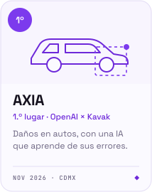</picture></a>
<a href="https://github.com/rvvictor/HackADA-Upiixia"><picture><source media="(prefers-color-scheme: dark)" srcset="assets/gen/hk-colonia-hackada-dark.svg">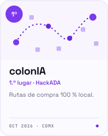</picture></a>
<a href="https://github.com/rvvictor/Chilangaton-Upiixia"><picture><source media="(prefers-color-scheme: dark)" srcset="assets/gen/hk-colonia-chilangaton-dark.svg">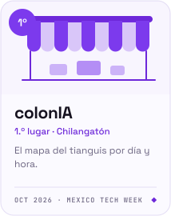</picture></a>
<picture><source media="(prefers-color-scheme: dark)" srcset="assets/gen/hk-mercuria-sedeco-x-saptiva-ai-dark.svg"></picture>
 
<a href="https://github.com/FerVarg24/LumivIA"><picture><source media="(prefers-color-scheme: dark)" srcset="assets/gen/hk-lumivia-talent-land-dark.svg">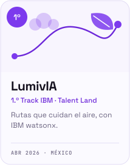</picture></a>
<a href="https://github.com/AxolutionsDevs/EvenLabs-Hack"><picture><source media="(prefers-color-scheme: dark)" srcset="assets/gen/hk-psyness-elevenlabs-hackathon-dark.svg">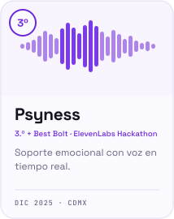</picture></a>
<a href="https://github.com/AxolutionsDevs/MobilityAI-Hackaton"><picture><source media="(prefers-color-scheme: dark)" srcset="assets/gen/hk-railsense-mobility-ai-dark.svg">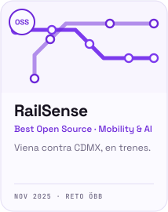</picture></a>

<picture><source media="(prefers-color-scheme: dark)" srcset="assets/gen/sec-stack-dark.svg"></picture>

<picture><source media="(prefers-color-scheme: dark)" srcset="assets/gen/stack-dark.svg"></picture>

<picture><source media="(prefers-color-scheme: dark)" srcset="assets/gen/sec-actividad-dark.svg"></picture>

<picture><source media="(prefers-color-scheme: dark)" srcset="assets/gen/activity-dark.svg">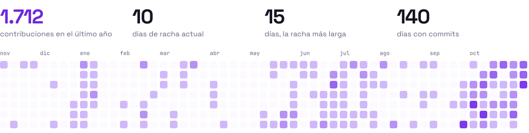</picture>

<picture><source media="(prefers-color-scheme: dark)" srcset="assets/gen/sec-contacto-dark.svg"></picture>

<a href="https://www.linkedin.com/in/joahan-morales/"><picture><source media="(prefers-color-scheme: dark)" srcset="assets/gen/ct-linkedin-dark.svg">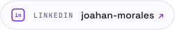</picture></a>
<a href="mailto:joahanmorales07@gmail.com"><picture><source media="(prefers-color-scheme: dark)" srcset="assets/gen/ct-correo-dark.svg"></picture></a>

